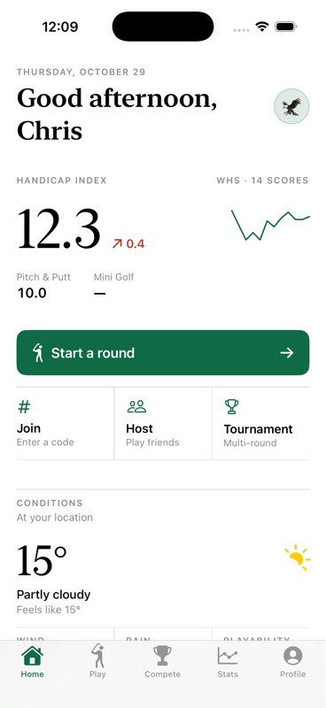
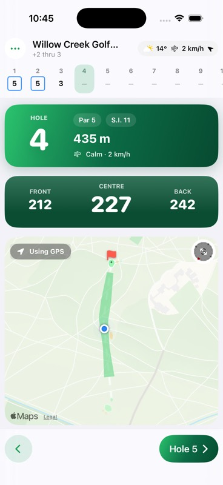
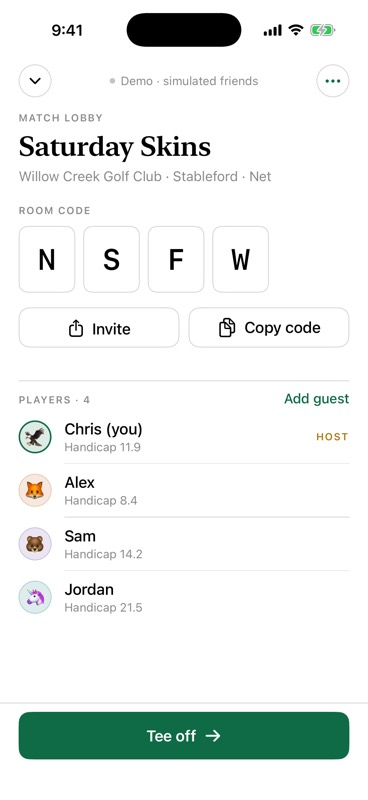
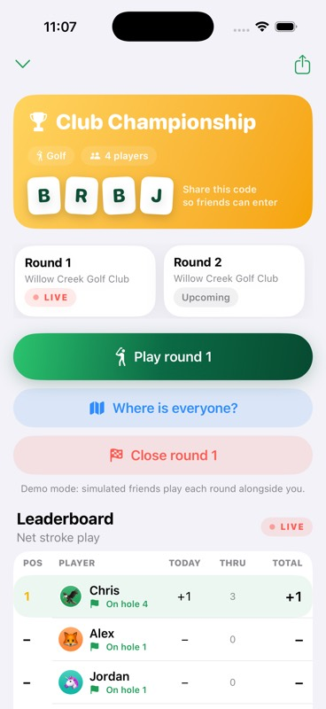
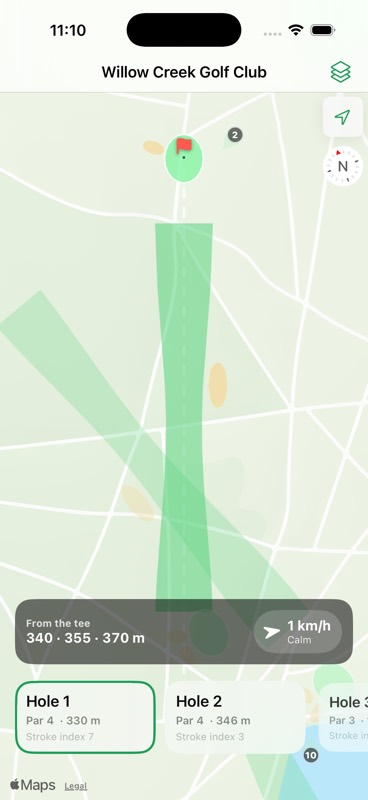
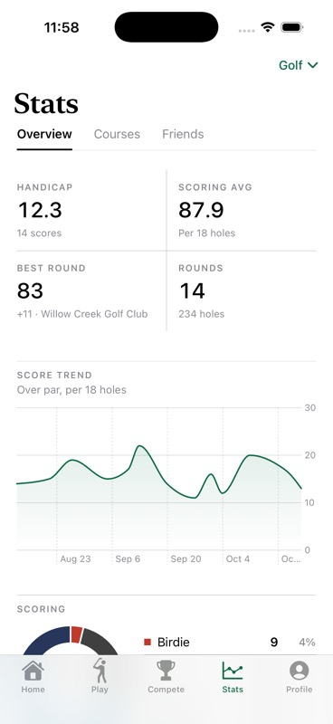
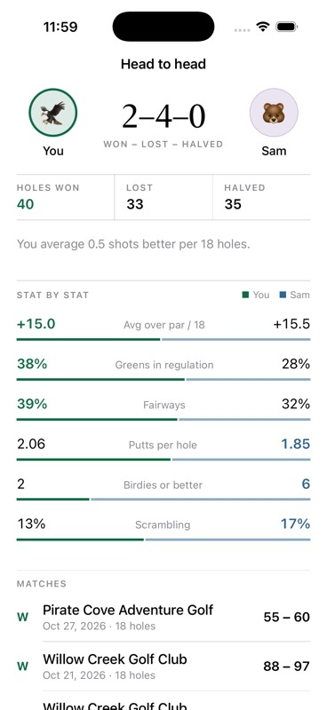
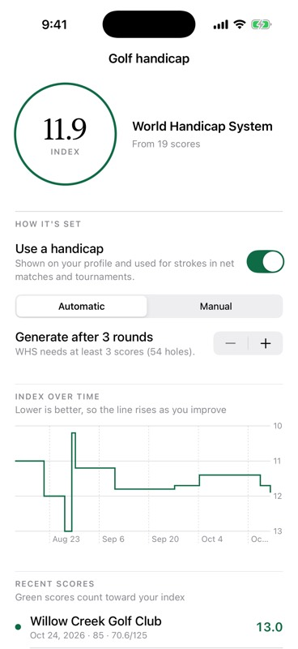

# Fairway ⛳️

An iOS golf app for golf, pitch & putt and mini golf. Track every shot with GPS, play friends using a four-letter room code (Jackbox-style), run multi-round tournaments with a live leaderboard, and dig into stats per course, per hole and head-to-head. It also builds your handicap automatically.

Everything runs on free services: [OpenGolfAPI](https://opengolfapi.org) for course data, [OpenStreetMap](https://www.openstreetmap.org) for hole maps, [Open-Meteo](https://open-meteo.com) for weather, Apple MapKit for imagery and, optionally, a free [Supabase](https://supabase.com) project for online play.

<p align="center">
  
  
  
  
</p>
<p align="center">
  
  
  
  
</p>

<sub>Screenshots are captured automatically by CI from the iOS Simulator (Debug builds accept <code>-FairwayScreen &lt;name&gt;</code>; push a commit containing <code>[screenshots]</code> to refresh them).</sub>

## Features

| Area | What you get |
| --- | --- |
| **Units** | Metric by default (metres, °C, km/h), switchable to imperial (yards, °F, mph) in onboarding or Settings. Everything is stored in metric. |
| **Courses** | Name search through OpenGolfAPI (scorecards, stroke indexes, tees with rating/slope); worldwide "near me" search through OpenStreetMap, which also finds pitch & putts and mini golf. You can create custom courses and fix pars. |
| **Game types** | Golf (WHS handicap, fairways, GIR, GPS), pitch & putt (par 3s, GIR, putts, GPS), mini golf (stroke cap of 6, no GPS needed). |
| **Live scoring** | Hole strip with scorecard symbols, big +/− steppers, putts, fairway left/hit/right, penalties, handicap stroke dots, confetti on birdies, haptics. |
| **GPS shot tracking** | Mark each shot where the ball lies. The app links shots, measures each one, works out the lie from the map (tee, fairway, rough, bunker, green), and derives strokes, putts, *shots to the green* and *shots to the hole*. It shows live "last shot: 231 m" as you walk, and front/centre/back distances to the green with a wind-adjusted "plays like" number. With no GPS (or at home) you can tap the map to place the ball instead. |
| **Matches** | Host a match and get a code like `KPLT`. Friends type it on a big letter keypad and appear in the lobby. Formats: stroke play, stableford, match play and skins, gross or net. You can add guests who don't have the app. The live leaderboard shows everyone's current hole, and friends' positions appear on the map. |
| **Tournaments** | Multi-round events with their own join code. The host opens each round, which becomes a live match everyone plays into. Standings show today/thru/total and each player's current hole. Each player gets a detail page with GIR, fairways, putts, birdies, par-3/4/5 averages, a running score chart and per-round cards. |
| **Stats** | Score trend, scoring distribution, putts, shots to green, GIR, scrambling, sand saves, 1- and 3-putts, fairway miss tendency, par-type averages and club distances (from GPS). Per course: a hole-by-hole heat map with the toughest and easiest holes. Friends: a leaderboard across shared matches plus head-to-head (W–L–T, holes won and stat-by-stat comparison). |
| **Handicap** | Automatic World Handicap System index after a number of rounds you choose (3–20, default 3), or enter your official index manually. It uses net double bogey caps, the full WHS table of best scores, 9-hole handling and course handicaps from slope and rating. Pitch & putt and mini golf get their own casual index. |
| **Weather** | Current conditions, the next 6 hours and a "playability" score, plus wind relative to the hole you're on. |
| **Course maps** *(stretch goal)* | Every mapped hole is drawn from OpenStreetMap (fairways, greens, tees, bunkers, water) over satellite imagery, rotated tee-to-green. Swipe through holes and tap to measure layups. |
| **Replays** *(stretch goal)* | Watch your round back: the ball flies along each shot with distances, hole by hole. Match replays show everyone's shots side by side in different colours. |
| **Design** | A flat, editorial layout instead of boxed cards: hairline rules and tables, one deep-green accent, serif headlines over tabular figures, and light and dark modes. Motion is kept small: numbers roll into place, sparklines and bars draw in, tabs slide, and a ring pulses around a birdie. |

## Getting started

Requirements: **Xcode 16 or later**, iOS 17+ device or simulator.

1. Open `Fairway.xcodeproj`.
2. Select the **Fairway** target → *Signing & Capabilities* → choose your team. Change the bundle identifier if Xcode asks.
3. Run on a simulator or your iPhone.

On first launch you pick a name, an avatar, units and handicap mode. You can also load sample rounds so every stats screen has data to show. Three fully mapped **demo courses** (golf, pitch & putt, mini golf) let you try maps, replays and matches anywhere.

**Offline demo mode** is the default. When you host a match, simulated friends join your lobby and play along hole by hole (never more than one hole ahead of you), so you can see the whole multiplayer flow on one device.

### Simulator tips

- *Features → Location* in the Simulator sets a GPS position. Or switch the live round map to **"Tap map to place ball"** and tap where your ball is.
- Demo courses use a drawn map style, since their holes are synthetic. Real courses use satellite imagery.

## Playing online with friends (free)

Online play uses your own free Supabase project, with no server code to run:

1. Create a project at [supabase.com](https://supabase.com).
2. **Authentication → Sign In / Providers**: enable **Allow anonymous sign-ins**.
3. **SQL Editor**: run [`supabase/schema.sql`](supabase/schema.sql). It creates the tables and row-level security policies, so a phone can only edit the scorecards it owns.
4. **Project Settings → API**: copy the project ref and the `anon` public key.
5. Either paste them into **Settings → Online Play** on each phone, or put them in [`Fairway/App/OnlineConfig.swift`](Fairway/App/OnlineConfig.swift) so everyone running your build is online automatically.

Friends then need the app on their phones (for example via TestFlight, which requires an Apple Developer account, or by building it from this repo).

## Data sources and limits

| Service | Used for | Cost / limits | Licence |
| --- | --- | --- | --- |
| OpenGolfAPI | Course search, scorecards, tees, ratings | Free; 1,000 requests/day anonymously, more with a free key (Settings) | ODbL |
| OpenStreetMap (Overpass API) | Hole geometry, nearby courses worldwide | Free, fair use; layouts are cached on device for 60 days | ODbL |
| Open-Meteo | Weather forecast | Free, no key | CC BY 4.0 |
| Apple MapKit | Satellite imagery, maps | Free with the iOS SDK | — |
| Supabase (optional) | Online matches and tournaments | Free tier | — |

Coverage notes:
- OpenGolfAPI's coverage is strongest in the US. Elsewhere, nearby search finds courses through OpenStreetMap, but scorecards may be missing. Tap **Edit** on the scorecard to set pars.
- Hole maps exist only where volunteers have traced the course on OpenStreetMap. If yours is missing, you can add it at openstreetmap.org (`golf=hole`, `golf=green`, `golf=tee`, `golf=fairway`, `golf=bunker`). GPS shot distances still work without a map.
- The calculated handicap follows WHS rules but isn't an official index. It doesn't apply the 12-month soft/hard caps or playing conditions adjustments, and it uses par and slope 113 when a course has no published rating.

## Project layout

```
Fairway.xcodeproj           Xcode 16 project (synchronised folder, no file list to maintain)
Fairway/                    SwiftUI app
  App/                      App entry, AppModel (state + persistence + services), online config
  DesignSystem/             Theme, cards, buttons, score badges, confetti, weather views
  Services/                 Location, live match & tournament sessions
  Features/                 Onboarding, Home, Courses, Play, Compete, Stats, Profile, Map
Packages/GolfKit/           Pure-Swift core, shared with tests (runs on macOS and Linux)
  Sources/GolfKit/
    Models/                 Course, holes, tees, shots, scores, rounds, players
    Geo/                    Distances, bearings, polygons, hole layouts, green front/centre/back
    Handicap/               World Handicap System + casual index
    Stats/                  Round, player, course/hole stats; head-to-head; friends leaderboard
    Competition/            Matches, join codes, leaderboards, tournaments, sync services
    Services/               OpenGolfAPI, Open-Meteo and Overpass clients
    Replay/                 Replay timelines
    Demo/                   Demo courses, layouts, simulated players, sample history
    Persistence/            On-device library storage
supabase/schema.sql         Online play database schema and security policies
```

The GolfKit package holds all the golf logic, networking and multiplayer sync. It has no UI or Apple-only dependencies, so it's fully unit-tested:

```bash
swift test --package-path Packages/GolfKit
```

CI (`.github/workflows/ci.yml`) runs those tests on Linux and macOS and builds the app for the iOS Simulator on every push.
